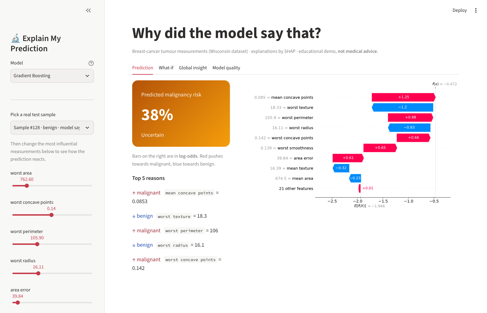
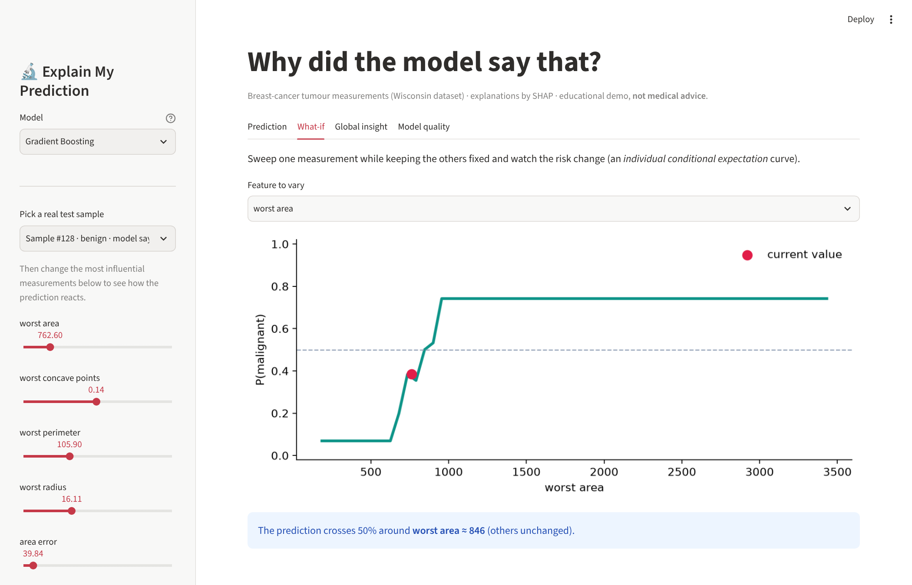
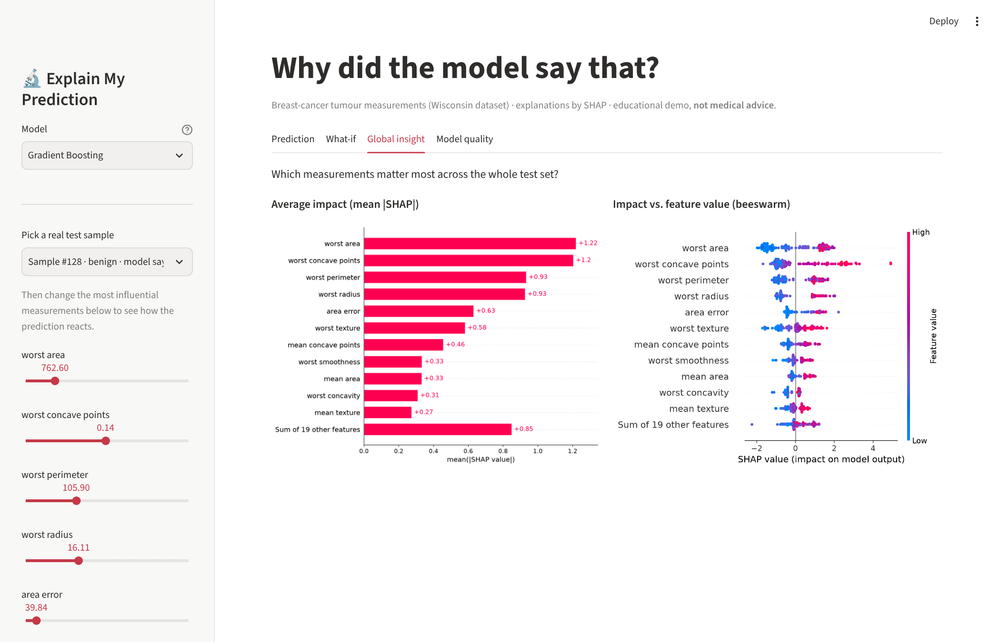
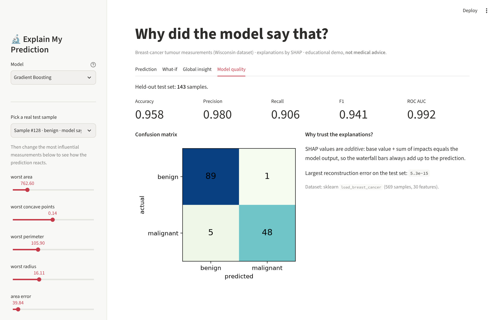

# 🔬 Explain My Prediction

An interactive **explainable-ML** demo. Pick a tumour sample, change its measurements, and see **why** a model predicts benign or malignant, not just *what* it predicts.

Built with scikit-learn, [SHAP](https://github.com/shap/shap) and Streamlit.

> ⚠️ Educational project on a public research dataset. **Not medical advice.**

| Prediction + SHAP waterfall | What-if curve |
|---|---|
|  |  |

| Global insight | Model quality |
|---|---|
|  |  |

## Features

- **Three models** on the same split: Gradient Boosting, Random Forest, Logistic Regression.
- **Local explanation**: SHAP waterfall plus plain-language "top 5 reasons" for one sample.
- **What-if analysis**: edit the 8 most influential measurements with sliders, or sweep one feature and see where the prediction flips (individual conditional expectation curve).
- **Global explanation**: mean |SHAP| bar chart and beeswarm over the whole test set.
- **Model quality**: accuracy, precision, recall, F1, ROC AUC, confusion matrix.
- **Verified explanations**: unit tests check that `base value + sum(SHAP) == model output`, so the bars really add up to the prediction.

## Quick start

```bash
git clone https://github.com/mr66174881-netizen/explain-my-prediction.git
cd explain-my-prediction

python -m venv .venv
# Windows:  .venv\Scripts\activate
# macOS/Linux:  source .venv/bin/activate

pip install -r requirements.txt
streamlit run app.py
```

Run the tests:

```bash
pytest -q
```

Python 3.10-3.12 recommended (SHAP depends on numba).

## How it works

1. `src/model.py` loads the Wisconsin breast-cancer data (569 samples, 30 features), makes a stratified train/test split and trains a `StandardScaler` + classifier pipeline.
2. `src/explain.py` wraps `shap.TreeExplainer` / `shap.LinearExplainer` behind one interface. Every explanation is flipped to be about the **malignant** class, so a positive (red) value always pushes towards malignant. Random Forest explanations are in probability units, the other two in log-odds.
3. `app.py` is the Streamlit UI. It starts on the most *uncertain* test sample, because that is where explanations are most interesting.

```
.
├── app.py              # Streamlit app
├── src/
│   ├── model.py        # data, training, metrics
│   └── explain.py      # SHAP wrapper
├── tests/test_xai.py   # accuracy + SHAP additivity tests
├── docs/               # screenshots
└── requirements.txt
```

## Limitations

- Small, clean, well-studied dataset; real clinical data is far messier.
- SHAP shows what the **model** relies on, not causal effects in the patient.
- Correlated features (for example radius, perimeter and area) share credit, so individual bars should be read with care.

## Ideas for next steps

- Add LIME and compare it with SHAP.
- Counterfactual explanations ("the smallest change that flips the prediction").
- Calibration curves and uncertainty estimates.
- Deploy on Streamlit Community Cloud.

## License

MIT